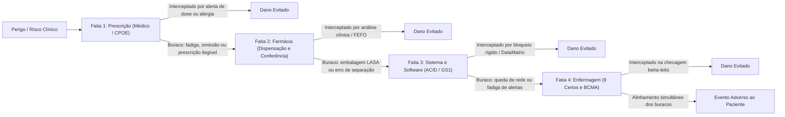

# O Modelo do Queijo Suíço: Da Segurança do Paciente à Arquitetura de Sistemas Críticos de Saúde

> **Resumo Executivo:** O Modelo do Queijo Suíço, formulado pelo psicólogo britânico James Reason, demonstra que falhas catastróficas em sistemas complexos raramente decorrem do erro isolado de um indivíduo. Acidentes ocorrem quando vulnerabilidades latentes (de projeto, gestão ou processo) se combinam com falhas ativas na ponta, alinhando os "buracos" de múltiplas barreiras defensivas. Este documento consolida a evolução histórica desse modelo (da engenharia nuclear à aviação e à medicina), apresenta sua aplicação na segurança medicamentosa hospitalar, estabelece o paralelo com a engenharia de software moderna (*Defesa em Profundidade*, *DevSecOps* e *SRE*) e detalha diretrizes práticas de arquitetura, UX defensiva e modelagem de dados em PostgreSQL para sistemas críticos de controle de estoque e dispensação de medicamentos.

---

## Sumário

1. [Origem e Evolução Histórica](#1-origem-e-evolução-histórica)
2. [O Modelo na Segurança do Paciente e Cadeia Medicamentosa](#2-o-modelo-na-segurança-do-paciente-e-cadeia-medicamentosa)
3. [Transposição para Engenharia de Software: Defesa em Profundidade, DevSecOps e SRE](#3-transposição-para-engenharia-de-software-defesa-em-profundidade-devsecops-e-sre)
4. [Aplicação Prática: Arquitetura e UX Defensiva em Sistemas de Estoque e Dispensação](#4-aplicação-prática-arquitetura-e-ux-defensiva-em-sistemas-de-estoque-e-dispensação)
5. [Modelagem de Dados e Triagem Clínica: PostgreSQL e JSONB vs. NoSQL](#5-modelagem-de-dados-e-triagem-clínica-postgresql-e-jsonb-vs-nosql)
6. [Referências e Marcos Normativos](#6-referências-e-marcos-normativos)

---

## 1. Origem e Evolução Histórica

Embora o Modelo do Queijo Suíço tenha se popularizado mundialmente por meio da aviação e da medicina, suas raízes conceituais surgiram na intersecção entre a **psicologia cognitiva** e a **engenharia de confiabilidade nuclear**.

### 1.1 A Base na Engenharia Nuclear e Psicologia Cognitiva (Anos 1980–1990)

- **Colaboração interdisciplinar:** Após grandes desastres industriais, como Three Mile Island (1979) e Chernobyl (1986), o psicólogo britânico **James Reason** (Universidade de Manchester) uniu esforços com o engenheiro nuclear **John Wreathall**, especialista em análise probabilística de risco (*PRA*) e confiabilidade humana (*HRA*). Eles integraram a taxonomia cognitiva do erro humano ao conceito de **"defesa em profundidade"** (*defense in depth*) já adotado em usinas nucleares e na indústria petroquímica.
- **Publicação seminal (*Human Error*, 1990):** No livro *Human Error* (1990), Reason demonstrou que acidentes organizacionais resultam da interação entre **falhas ativas** (erros ou violações cometidos por operadores na linha de frente, o *sharp end*) e **condições latentes** (vulnerabilidades ocultas em decisões gerenciais, projeto de equipamentos, sobrecarga de trabalho ou processos mal desenhados, o *blunt end*).
- **Consolidação teórica (1997):** Em *Managing the Risks of Organizational Accidents* (1997), Reason amadureceu a representação gráfica das camadas de defesa com aberturas dinâmicas, que se abrem, fecham e deslocam continuamente, consolidando a formulação moderna do modelo.

### 1.2 O Batismo e a Adoção Global na Aviação (Anos 1990)

- **A origem do nome "Queijo Suíço":** O apelido visual não foi criado originalmente por Reason, mas cunhado e popularizado por **Rob Lee**, então diretor do órgão australiano de investigação de acidentes aeronáuticos **BASI** (*Bureau of Air Safety Investigation*, atual ATSB), para ilustrar o modelo em investigações e treinamentos de segurança de voo. Reason adotou e elogiou publicamente a metáfora (*"I am indebted to him, because I love the name"*), e ambos colaboraram com **Daniel Maurino** e **Neil Johnston** no livro *Beyond Aviation Human Factors* (1995).
- **Padronização internacional pela ICAO:** No início da década de 1990, a Organização da Aviação Civil Internacional (**ICAO**) constatou que a maior parte dos acidentes ainda era atribuída simploriamente a "erro do piloto". Por meio de publicações como os **Human Factors Digests nº 7** (Circular 240-AN/144, 1993) e **nº 10** (Circular 247-AN/148, 1993), a ICAO institucionalizou a abordagem sistêmica de Reason, estabelecendo barreiras sobrepostas em projetos de aeronaves, manutenção, controle de tráfego aéreo, treinamento em simuladores, *checklists* e *Crew Resource Management (CRM)*, que formam a base dos atuais Sistemas de Gerenciamento da Segurança Operacional (*SMS*).

### 1.3 A Chegada à Medicina e à Segurança do Paciente (1999–2013)

- **O ponto de inflexão (*To Err Is Human* e *The BMJ*):** Em 1999, o *Institute of Medicine* (IOM) dos Estados Unidos publicou o relatório *To Err Is Human: Building a Safer Health System*, expondo a magnitude das mortes evitáveis por falhas assistenciais. Logo depois, em março de 2000, James Reason publicou na revista *The BMJ* o artigo clássico **"Human error: models and management"**, traduzindo o modelo das fatias de queijo diretamente para médicos e gestores hospitalares.
- **Da teoria à prática assistencial:** A saúde passou a incorporar sistematicamente ferramentas de setores de alta confiabilidade (*High-Reliability Organizations - HROs*), como a Lista de Verificação de Segurança Cirúrgica da Organização Mundial da Saúde (**WHO Surgical Safety Checklist**, 2008) e sistemas confidenciais/não punitivos de notificação de incidentes e *near misses* (quase-erros).
- **Marco regulatório no Brasil:** Em 2013, o Ministério da Saúde e a **Anvisa** instituíram o Programa Nacional de Segurança do Paciente (**PNSP**), por meio da **RDC nº 36/2013** e da **Portaria MS/GM nº 2.095/2013**, tornando obrigatórios os Núcleos de Segurança do Paciente (NSP) e protocolos nacionais como o de **Segurança na Prescrição, Uso e Administração de Medicamentos**.

---

## 2. O Modelo na Segurança do Paciente e Cadeia Medicamentosa

Na prática clínica moderna, cada etapa do ciclo do medicamento atua como uma fatia de queijo destinada a interceptar falhas antes que atinjam o paciente.



### 2.1 As Principais Barreiras no Fluxo Hospitalar

1. **Prescrição e Diagnóstico (Corpo Clínico)**
   - **Papel da barreira:** Avaliar o quadro clínico, realizar a conciliação medicamentosa e prescrever o fármaco adequado na dose, via, diluição e posologia corretas.
   - **Vulnerabilidades ("buracos") comuns:** Fadiga em plantões extenuantes, prescrição manuscrita ilegível (em ambientes sem prontuário eletrônico), abreviações ambíguas (ex.: `U` vs. `0`), interrupções durante a prescrição e ausência de histórico consolidado de alergias ou função renal/hepática.

2. **Dispensação e Validação Clínica (Farmácia Hospitalar)**
   - **Papel da barreira:** Validar tecnicamente a prescrição (dose máxima, ajustes renais/pediátricos, interações medicamentosas e incompatibilidades em Y), gerenciar estoques e dispensar o item e lote exatos.
   - **Vulnerabilidades ("buracos") comuns:** Confusão entre medicamentos **LASA** (*Look-Alike, Sound-Alike*, nomes ou embalagens semelhantes), sobrecarga de pedidos urgentes, substituições não comunicadas por falta de estoque e falha na dupla checagem de **Medicamentos Potencialmente Perigosos (MPP)** / Alta Vigilância.

3. **Administração e Monitoramento (Enfermagem)**
   - **Papel da barreira:** Executar o protocolo dos **"9 Certos"** da administração segura de medicamentos (conforme diretriz do Ministério da Saúde / Anvisa / Fiocruz, evoluída dos antigos "5 certos") e monitorar a resposta terapêutica:
     1. *Paciente certo* (com ao menos dois identificadores na pulseira);
     2. *Medicamento certo*;
     3. *Dose certa*;
     4. *Via certa*;
     5. *Horário certo*;
     6. *Registro certo* (documentação imediata em prontuário);
     7. *Ação/Razão certa* (coerência clínica com o quadro do paciente);
     8. *Forma farmacêutica certa*;
     9. *Monitoramento/Resposta certa* (observação de eficácia e reações adversas).
   - **Vulnerabilidades ("buracos") comuns:** Subdimensionamento da equipe (alta relação paciente/profissional), troca de etiquetas ou frascos no preparo simultâneo, pressa em emergências e falhas de comunicação na passagem de plantão.

   > **Nota de segurança sistêmica:** Conforme enfatiza o próprio protocolo oficial da Anvisa/MS, os "9 certos" constituem uma **barreira final importante**, mas não eliminam falhas se todas as camadas anteriores (prescrição estruturada, rotulagem segura, dispensação por dose unitária) estiverem comprometidas.

4. **O Sistema Institucional e Tecnológico (Camada Transversal)**
   - **Papel da barreira:** Envolver e sustentar as etapas humanas por meio de bloqueios físicos e digitais automatizados.
   - **Mecanismos de proteção:** Prontuário Eletrônico do Paciente (**PEP**) com prescrição estruturada (*CPOE*) e suporte à decisão clínica, administração assistida por código de barras à beira-leito (**BCMA** , conferindo pulseira do paciente + embalagem unitarizada), bombas de infusão inteligentes (*smart pumps* com biblioteca de fármacos e limites de dose), dispensários eletrônicos automatizados e dupla checagem independente obrigatória para MPPs.
   - **Vulnerabilidades ("buracos") do sistema:** **Fadiga de alertas** (excesso de avisos irrelevantes levando à dessensibilização e cliques automáticos), indisponibilidade de rede/energia sem plano de contingência, interfaces com baixa usabilidade (*UX*) e **cultura organizacional punitiva** (que silencia incidentes e impede a correção das causas latentes).

### 2.2 A Mudança de Mentalidade: Abordagem da Pessoa vs. Abordagem Sistêmica

No artigo de 2000 no *BMJ*, James Reason contrapôs duas visões de gerenciamento do erro:

- **Abordagem da Pessoa (*Person Approach*):** Trata o erro como falha moral ou desatenção individual (*"culpar, envergonhar e punir"*). Leva profissionais a esconderem falhas e *near misses*, mantendo intactas as armadilhas do ambiente.
- **Abordagem Sistêmica (*System Approach*):** Parte da premissa de que **errar é condição humana inevitável**, mesmo nas melhores equipes. O foco desloca-se de *"quem errou?"* para *"quais condições latentes permitiram que o erro ocorresse e por que as barreiras não o contiveram?"*, estruturando a gestão do erro em três pilares: **redução** (diminuir a probabilidade da falha), **contenção** (impedir que o dano chegue ao paciente) e **identificação precoce** (tornar o desvio visível rapidamente).

Na prática hospitalar contemporânea, essa visão integra-se ao conceito de **Cultura Justa (*Just Culture*)**: diferencia o erro humano honesto (que exige redesenho do processo e suporte ao profissional) do comportamento de risco ou da violação imprudente e deliberada de normas de segurança.

---

## 3. Transposição para Engenharia de Software: Defesa em Profundidade, DevSecOps e SRE

Na engenharia de software crítica, o Modelo do Queijo Suíço fundamenta a **Defesa em Profundidade** (*Defense in Depth*), o **DevSecOps** e a Engenharia de Confiabilidade de Sites (**SRE**). O princípio é idêntico: engenheiros e usuários cometerão falhas; logo, a arquitetura deve conter defeitos e vulnerabilidades antes que causem impacto em produção.

### 3.1 As "Fatias de Queijo" no Ciclo de Desenvolvimento (SDLC)

1. **Fatia 1 — Ambiente Local, Tipagem e Análise Estática:** Linguagens com sistema de tipos rigoroso (ex.: TypeScript em modo estrito, Rust, Go, Java/Kotlin), *linters*, formatadores e *pre-commit hooks*. Fecham erros básicos de sintaxe, contrato e tipos ainda na estação de trabalho.
2. **Fatia 2 — Pirâmide de Testes Automatizados:** Testes unitários (regras puras de domínio), testes de integração (persistência, transações e filas), testes de contrato de API e testes ponta a ponta (*E2E*). Impedem regressões em regras críticas de negócio.
3. **Fatia 3 — Revisão por Pares (*Code Review*):** Equivalente à dupla checagem clínica independente. Outro desenvolvedor avalia o *Pull Request* buscando falhas lógicas, condições de corrida, brechas de segurança e pontos cegos do autor.
4. **Fatia 4 — Esteira de CI/CD e Segurança (*DevSecOps*):** *Pipelines* automatizados que bloqueiam o *merge* ou *deploy* mediante falhas em testes ou detecção de vulnerabilidades por **SAST** (*Static Application Security Testing*), **DAST** (*Dynamic Application Security Testing*), **SCA** (análise de dependências/CVEs) e varredura de segredos.
5. **Fatia 5 — Implantação Progressiva (*Progressive Delivery*):** Adoção de *Canary Releases* (exposição inicial a 1%–5% do tráfego), *Blue-Green Deployment* e *Feature Flags*, permitindo isolamento de falhas (*blast radius* reduzido) e *rollback* instantâneo.
6. **Fatia 6 — Observabilidade e Resposta a Incidentes:** Logs estruturados (com *correlation/trace IDs*), métricas de negócio e infraestrutura, rastreamento distribuído, definição de **SLIs/SLOs** e alertas acionáveis, detectando desvios que tenham atravessado todas as camadas anteriores antes mesmo da notificação pelo usuário.

### 3.2 Práticas Convergentes entre Setores de Alto Risco e Software

| Prática / Método | Origem Histórica | Aplicação no Desenvolvimento de Software |
| :--- | :--- | :--- |
| **Blameless Post-Mortem** (Análise sem culpa) | Aviação (CRM / sistemas como o ASRS) e Cultura Justa na Medicina; formalizado em TI por **John Allspaw (Etsy, 2012)** e SRE | Após um incidente em produção, a equipe reconstrói a linha do tempo para identificar quais barreiras falharam e criar ações corretivas sistêmicas, sem punir quem executou o *deploy*. |
| **Checklists Operacionais** | Aviação (cabine pré-voo) e Medicina (*WHO Surgical Safety Checklist*, 2008) | Roteiros objetivos e verificáveis para procedimentos raros ou de alto risco, como migrações destrutivas de banco de dados, viradas de chave e resposta a incidentes sob estresse. |
| **Engenharia do Caos** (*Chaos Engineering*) | **Netflix (~2010–2011)** com o *Chaos Monkey* na migração para nuvem | Injeção controlada de falhas em ambientes reais ou de pré-produção (queda de réplicas, latência de rede, perda de dependências) para expor "buracos" latentes antes de crises reais. |
| **Princípio do Menor Privilégio** (*Least Privilege*) | Formalizado na computação por **Saltzer & Schroeder (1975)** (*Protection of Information in Computer Systems*), inspirado na compartimentalização militar/nuclear | Restringir usuários, microsserviços, tokens e conexões de banco ao conjunto mínimo de permissões necessárias, isolando o estrago caso uma credencial seja comprometida. |

### 3.3 Quadro Comparativo: O Alinhamento do Modelo nos Três Domínios

| Camada do Modelo | Segurança do Paciente (Hospital) | Engenharia de Software (Geral) | Sistema de Estoque e Dispensação Médica |
| :--- | :--- | :--- | :--- |
| **Prevenção na Origem** | Prescrição eletrônica estruturada (CPOE) | Tipagem forte, *linters* e validação de entrada | Tipagem de dose/unidade (UCUM) e leitura GS1 DataMatrix |
| **Verificação Intermediária** | Validação farmacêutica e conferência de dose | Testes automatizados e *Code Review* | Validação transacional de lote, validade, alergia e dupla checagem |
| **Bloqueio Automatizado** | Alertas clínicos e bombas inteligentes (*hard limits*) | *Quality gates* no CI/CD (SAST/DAST) | Constraints `CHECK`, `SELECT ... FOR UPDATE`, quarentena automática |
| **Barreira Final na Ponta** | Os "9 certos" e BCMA à beira-leito | *Canary release* e *Feature Flags* | UX defensiva, *Tall Man Lettering* e confirmação em etapas críticas |
| **Recuperação e Aprendizado** | Notificação anônima e análise de causa raiz | Observabilidade e *Blameless Post-Mortem* | *Ledger* contábil imutável e *snapshot* clínico de cada dispensação |

### 3.4 Adoção Incremental: Evitando a Fadiga de Processos

Tentar implantar todas as barreiras simultaneamente sem maturidade operacional produz burocracia excessiva, lentidão e **"fadiga de processos"**, cenário em que a própria equipe cria atalhos para contornar controles rígidos (*workarounds*, criando novos buracos latentes). A abordagem pragmática recomendada consiste em:

1. Identificar o incidente ou quase-erro mais crítico recente;
2. Conduzir uma análise sistêmica sem culpa;
3. Adicionar ou fechar **uma barreira objetiva e automatizada** (ex.: um teste de propriedade, uma trava no banco de dados ou uma regra de CI) que torne fisicamente impossível a repetição exata daquele alinhamento de falhas.

---

## 4. Aplicação Prática: Arquitetura e UX Defensiva em Sistemas de Estoque e Dispensação

Um software de controle de estoque e dispensação de medicamentos integra diretamente a malha de segurança do paciente: uma condição de corrida (*race condition*), a liberação de um lote vencido ou uma conversão errônea de unidade (`mg` vs. `mcg` ou `mg` vs. `mL`) pode causar eventos adversos graves ou fatais. A blindagem precisa atuar simultaneamente no **backend/banco de dados**, na **interface (UX defensiva)** e na **resiliência operacional**.

### 4.1 Blindagem no Backend e Banco de Dados (Integridade Absoluta)

Em sistemas farmacêuticos, **consistência e auditabilidade precedem a velocidade**.

- **Transações ACID e Controle de Concorrência:** Dois operadores não podem dar baixa simultânea na última ampola de um lote. Em operações de alta contenção sobre o mesmo lote, utilize bloqueio pessimista (`SELECT ... FOR UPDATE` no PostgreSQL) ou bloqueio otimista (coluna `version` com verificação atômica no `UPDATE`), combinados obrigatoriamente com uma **restrição física no banco** (`CHECK (quantidade_disponivel >= 0)`). Mesmo que um *bug* na aplicação tente gerar estoque negativo, o SGBD rejeitará a transação.
- **Ledger Imutável (*Append-Only* para Rastreabilidade Total):** Jamais altere saldos apenas com um `UPDATE` destrutivo sem histórico. Toda entrada, dispensação, devolução/estorno, perda, transferência ou bloqueio deve gerar um registro imutável em uma tabela de razão contábil de movimentações (contendo `tipo_movimento`, `lote_id`, `quantidade`, `usuario_id`, `motivo`, `referencia_prescricao_id` e `timestamp_utc`). Essa trilha é indispensável para auditorias clínicas e exigências sanitárias brasileiras — como o controle de substâncias sujeitas a controle especial (**Portaria SVS/MS nº 344/1998**) e antimicrobianos.
- **Bloqueio Automático por Validade, Quarentena e Recall:** Além de rotinas agendadas (*cron jobs*) para mover lotes expirados ou sob recolhimento (*recall* Anvisa) para o status `QUARENTENA`, a regra de bloqueio deve ser **validada em tempo real dentro da transação de dispensação** (`status = 'DISPONIVEL' AND data_validade >= (NOW() AT TIME ZONE :fuso_unidade)::date`). Confiar apenas em um *job* assíncrono cria um buraco caso o agendador falhe.
- **Precisão Numérica e Tipagem Forte para Doses e Unidades:** Nunca armazene doses ou saldos como ponto flutuante binário (`FLOAT`/`DOUBLE`), que sofre erros de arredondamento (ex.: `0.1 + 0.2`). Use `NUMERIC`/`DECIMAL` (ou submúltiplos inteiros canônicos) acoplados a um objeto de valor que vincule número e unidade padronizada pelo padrão **UCUM** (*Unified Code for Units of Measure*), distinguindo rigorosamente massa (`mg`, `ug`/`mcg`) de volume (`mL`) e unidades biológicas (`UI`), e bloqueando conversões sem dados explícitos de concentração (ex.: `mg/mL`).

### 4.2 UX Defensiva: Fechando os "Buracos" Humanos na Ponta

Profissionais de farmácia e enfermagem operam sob alta carga cognitiva e pressão de tempo. A interface deve ser projetada para tornar o caminho seguro o mais fácil de executar e o caminho inseguro bloqueado ou friccionado.

- **Leitura Obrigatória de Código de Barras (GS1 DataMatrix):** Exija a bipagem da embalagem na entrada e na dispensação. O código bidimensional **GS1 DataMatrix** codifica, via Identificadores de Aplicação (AIs), o produto (**AI 01 - GTIN**), o lote (**AI 10**), a data de validade (**AI 17**) e, quando serializado, o número de série (**AI 21**), eliminando erros de digitação manual.
  - *Contexto regulatório no Brasil:* Embora a **Lei nº 14.338/2022** (que instituiu a bula digital via QR Code) tenha revogado o modelo centralizado anterior do SNCM previsto na Lei nº 11.903/2009, o padrão **GS1 DataMatrix** permanece consolidado na indústria farmacêutica e nos hospitais como referência técnica para logística segura, controle de validade, dose unitária e atendimento aos mapas de rastreio e distribuição.
- **Destaque Visual para Medicamentos LASA e MPP (Alta Vigilância):**
  - Siga as listas e boletins do **ISMP Brasil** (*Instituto para Práticas Seguras no Uso de Medicamentos*) para destacar **Medicamentos Potencialmente Perigosos (MPP)** e pares **LASA** com etiquetas visuais diferenciadas e tipografia **Tall Man Lettering** (ex.: `dopaMINA` vs. `dobuTAMINA`; `predNIZONA` vs. `predNISOLONA`).
  - Exija **dupla checagem independente** (autenticação de um segundo profissional distinto no momento da dispensação, bloqueando no backend a autoaprovação pela mesma sessão ou usuário) para MPPs, quimioterápicos, eletrólitos concentrados e doses pediátricas críticas.
- **Combate à Fadiga de Alertas (*Alert Tiering*):** Classifique os avisos clínicos por criticidade para evitar que o usuário clique em "OK" por reflexo:
  - *Hard Stop (Bloqueio rígido):* Lote vencido, lote interditado/quarentena, estoque insuficiente, alergia grave documentada ao princípio ativo ou dose acima do teto letal;
  - *Soft Stop (Alerta com justificativa estruturada):* Interação medicamentosa moderada ou dose fora da faixa usual (exige seleção de justificativa clínica e registro em log);
  - *Passivo / Informativo:* Avisos operacionais sem interrupção do fluxo de tela.
- **Algoritmo FEFO (*First Expired, First Out*):** Na separação, o sistema deve ordenar e pré-selecionar automaticamente o lote válido com vencimento mais próximo, evitando desperdício financeiro e risco de vencimento em estoque, observando, contudo, se a validade do lote cobre integralmente o período de tratamento dispensado ao paciente.

### 4.3 Resiliência, Contingência e Casos de Borda (*Edge Cases*)

Hospitais operam 24/7 e não podem paralisar a dispensação em uma queda de rede ou falha de provedor em nuvem.

- **Modo Contingência e Continuidade Operacional:** Preveja sincronização offline segura (ou servidor local de borda em farmácias críticas) e geração periódica automática de pacotes de contingência (relatórios assinados com saldos por lote, validades e prescrições ativas), acompanhados de protocolo claro de reconciliação pós-retorno da rede.
- **Testes de Propriedade e Cenários Críticos de Borda:** Implemente suítes automatizadas focadas especificamente em casos complexos da farmácia hospitalar:
  - Estorno parcial de *kits* cirúrgicos e devoluções à farmácia satélite;
  - Fracionamento e conversão entre embalagem secundária (caixa) e unidade de dispensação (ampola/comprimido);
  - Devolução de termolábeis após saída da cadeia de frio (2 °C a 8 °C), exigindo bloqueio automático para avaliação de estabilidade antes da reintegração ao estoque;
  - Fronteiras de fuso horário na virada da data de validade (armazene eventos de auditoria em **UTC**, mas avalie validade de lote considerando a data local da unidade hospitalar e regras explícitas de vencimento no último dia do mês quando aplicável).

---

## 5. Modelagem de Dados e Triagem Clínica: PostgreSQL e JSONB vs. NoSQL

Ao implementar formulários dinâmicos de triagem clínica e conferência durante a dispensação (ex.: checagem de gestação, aleitamento, faixa etária ou contraindicações específicas por fármaco), surge uma dúvida recorrente de arquitetura: *introduzir um banco NoSQL (como MongoDB) ou manter um banco relacional único?*

Em sistemas críticos de estoque e dispensação medicamentosa, **não é recomendável introduzir um segundo banco NoSQL apenas para perguntas dinâmicas**. O recurso de `JSONB` em um banco relacional moderno como o **PostgreSQL** resolve a flexibilidade de esquema com segurança muito superior e menor complexidade operacional.

### 5.1 O Risco Arquitetural da Persistência Poliglota (SQL + NoSQL)

Separar o saldo de estoque (no banco relacional) e o questionário clínico de triagem (em um banco NoSQL externo) abre um **"buraco" arquitetural grave**: a perda da **atomicidade transacional (ACID)** entre os dois registros.

Se o sistema gravar a resposta clínica no NoSQL e tentar baixar o estoque no PostgreSQL em seguida, uma queda de rede, *timeout* ou falha de processo no meio do caminho pode resultar em:
- Baixa física de medicamento sem o registro legal de segurança clínica; ou
- Registro de dispensação clínica sem dedução real do lote (dessincronização de inventário).

Contornar isso exigiria transações distribuídas complexas (*2PC*) ou padrões de mensageria/Saga (*Outbox Pattern*), introduzindo latência operacional, risco de inconsistência eventual e maior superfície de falha sem benefício proporcional.

### 5.2 Arquitetura Híbrida em Banco Único: PostgreSQL + Relacional + `JSONB`

É possível unir rigor referencial e flexibilidade documental dentro da mesma transação ACID no PostgreSQL:

1. **Regras e Perguntas Reutilizáveis (Modelo Relacional Clássico):** Perguntas clínicas recorrentes (ex.: *"Paciente gestante ou com suspeita de gravidez?"*, *"Paciente menor de 2 anos?"*) ficam normalizadas em uma tabela `regras_clinicas`, vinculadas a medicamentos individuais (`medicamento_regras`) ou herdadas por **classe terapêutica** (ex.: usando a classificação **ATC** (*Anatomical Therapeutic Chemical* da OMS), para que todo anti-inflamatório não esteroidal herde automaticamente o alerta de risco gestacional).
2. **Perguntas Específicas e Respostas Dinâmicas (`JSONB` + Índice `GIN`):** Requisitos muito particulares de um princípio ativo ou formulários variáveis são armazenados em coluna `JSONB` indexada por `GIN`, mantendo consultas rápidas por atributos internos.
3. **Imutabilidade do Registro (*Snapshot* Legal e Clínico):** No momento exato em que o farmacêutico finaliza a dispensação, o sistema grava na mesma transação uma **cópia imutável (`snapshot` em `JSONB`)** contendo: o identificador e versão da regra clínica aplicada, o texto exato exibido na tela, as respostas fornecidas e o profissional responsável. Se a regra clínica for editada meses depois, a evidência legal do que foi verificado naquela data permanece inalterada.

#### Exemplo Ilustrativo de Esquema e Transação Atômica (PostgreSQL)

```sql
-- 1. Lotes com guarda rígida contra saldo negativo no próprio SGBD
CREATE TABLE estoque_lotes (
    id              BIGSERIAL PRIMARY KEY,
    medicamento_id  BIGINT NOT NULL,
    codigo_lote     TEXT NOT NULL,
    gtin            VARCHAR(14) NOT NULL,
    data_validade   DATE NOT NULL,
    status          TEXT NOT NULL CHECK (status IN ('DISPONIVEL', 'QUARENTENA', 'VENCIDO', 'RECALL')),
    quantidade      NUMERIC(12, 4) NOT NULL CHECK (quantidade >= 0),
    unidade_ucum    VARCHAR(16) NOT NULL,
    UNIQUE (medicamento_id, codigo_lote)
);

-- 2. Dispensação com snapshot imutável da triagem clínica (JSONB + GIN)
CREATE TABLE dispensacoes (
    id                  BIGSERIAL PRIMARY KEY,
    prescricao_id       BIGINT NOT NULL,
    paciente_id         BIGINT NOT NULL,
    lote_id             BIGINT NOT NULL REFERENCES estoque_lotes(id),
    quantidade          NUMERIC(12, 4) NOT NULL CHECK (quantidade > 0),
    triagem_snapshot    JSONB NOT NULL,
    dupla_checagem_por  BIGINT, -- obrigatório via regra/trigger para MPPs
    realizada_por       BIGINT NOT NULL,
    criada_em_utc       TIMESTAMPTZ NOT NULL DEFAULT NOW(),
    CHECK (dupla_checagem_por IS NULL OR dupla_checagem_por <> realizada_por)
);

CREATE INDEX idx_dispensacoes_triagem_gin ON dispensacoes USING GIN (triagem_snapshot);

-- 3. Ledger contábil imutável (append-only)
CREATE TABLE movimentacoes_estoque (
    id              BIGSERIAL PRIMARY KEY,
    lote_id         BIGINT NOT NULL REFERENCES estoque_lotes(id),
    tipo            TEXT NOT NULL CHECK (tipo IN ('ENTRADA', 'DISPENSACAO', 'ESTORNO', 'PERDA', 'QUARENTENA')),
    delta           NUMERIC(12, 4) NOT NULL,
    dispensacao_id  BIGINT REFERENCES dispensacoes(id),
    motivo          TEXT NOT NULL,
    executado_por   BIGINT NOT NULL,
    criado_em_utc   TIMESTAMPTZ NOT NULL DEFAULT NOW()
);

-- 4. Fluxo transacional atômico na dispensação (bloqueio pessimista + validação em tempo real)
BEGIN;

SELECT quantidade, status, data_validade
FROM estoque_lotes
WHERE id = :lote_id
FOR UPDATE;

-- Validação com a data local da unidade hospitalar (evitando divergência de fuso horário UTC)
UPDATE estoque_lotes
SET quantidade = quantidade - :qtd
WHERE id = :lote_id
  AND status = 'DISPONIVEL'
  AND data_validade >= (NOW() AT TIME ZONE 'America/Sao_Paulo')::date
  AND quantidade >= :qtd;

INSERT INTO dispensacoes (prescricao_id, paciente_id, lote_id, quantidade, triagem_snapshot, realizada_por)
VALUES (:prescricao_id, :paciente_id, :lote_id, :qtd, :snapshot_jsonb, :usuario_id)
RETURNING id INTO :disp_id;

INSERT INTO movimentacoes_estoque (lote_id, tipo, delta, dispensacao_id, motivo, executado_por)
VALUES (:lote_id, 'DISPENSACAO', -:qtd, :disp_id, 'Dispensação vinculada à prescrição', :usuario_id);

COMMIT;
```

### 5.3 Modelagem Estruturada para Alergias: Princípio Ativo, Classe e Reatividade Cruzada

Evite modelar verificações de alergia como perguntas manuais em texto livre (ex.: digitar *"É alérgico a Dipirona?"* no cadastro de dezenas de apresentações comerciais), pois falhas de cadastro abrem buracos silenciosos na barreira de segurança.

- **Normalização por Vocabulário Controlado (DCB e ATC):** Cadastre os **Princípios Ativos** utilizando a **DCB** (*Denominação Comum Brasileira*, mantida pela Anvisa) e vincule-os às apresentações comerciais (medicamentos de referência, genéricos e similares) e à árvore terapêutica/química **ATC**.
- **Geração Dinâmica de Alertas:** Ao dispensar qualquer marca comercial, o sistema inspeciona os princípios ativos daquela formulação (incluindo medicamentos compostos) e cruza automaticamente com o histórico estruturado de alergias do paciente.
- **Alergia Intra-Classe vs. Reatividade Cruzada Real:**
  - *Alergia intra-classe (mesmo grupo estrutural):* Se um paciente possui alergia registrada à **penicilina** (como benzilpenicilina), o sistema deve bloquear ou emitir alerta crítico na tentativa de dispensar **amoxicilina** ou **ampicilina**, pois estas são aminopenicilinas, pertencentes à **mesma classe das penicilinas**.
  - *Reatividade cruzada (grupos distintos com similaridade molecular):* Com uma tabela explícita de grupos químicos e cadeias laterais (*side chains*), o sistema consegue modelar **reatividade cruzada** de forma clinicamente precisa, por exemplo, diferenciando o baixo risco geral entre penicilinas e cefalosporinas (~1% a 2%) do risco específico elevado entre **amoxicilina** e cefalosporinas que compartilham cadeia lateral R1 semelhante (como **cefalexina** e **cefaclor**), enquanto preserva alternativas seguras com cadeias laterais distintas (como **cefazolina** ou cefalosporinas de 3ª/4ª geração, salvo histórico de reações graves como síndrome de Stevens-Johnson).

### 5.4 Quando o NoSQL (ou Armazenamento Documental Dedicado) Faria Sentido?

A adoção de um banco orientado a documentos dedicado (como MongoDB) ou *object storage* indexado só se justificaria caso o escopo evoluísse para um **Prontuário Eletrônico completo (PEP/EHR)** com:
- Anamneses altamente heterogêneas e livres por dezenas de especialidades médicas;
- Grande volume de documentos clínicos não estruturados, laudos extensos ou árvores complexas de recursos interoperáveis (ex.: repositórios massivos de eventos **HL7 FHIR** desacoplados do fluxo transacional de farmácia).

Mesmo nesse cenário, o núcleo de **estoque, rastreabilidade de lotes e dispensação** deve permanecer isolado em banco relacional ACID, evitando comprometer a integridade transacional da barreira mais crítica do sistema.

---

## 6. Referências e Marcos Normativos

1. **Reason, J.** (1990). *Human Error*. Cambridge: Cambridge University Press.
2. **Maurino, D. E., Reason, J., Johnston, N., & Lee, R. B.** (1995). *Beyond Aviation Human Factors: Safety in High Technology Systems*. Aldershot: Avebury Aviation.
3. **Reason, J.** (1997). *Managing the Risks of Organizational Accidents*. Aldershot: Ashgate Publishing.
4. **Reason, J.** (2000). *Human error: models and management*. *BMJ*, 320(7237), 768–770.
5. **ICAO — International Civil Aviation Organization** (1993). *Human Factors Digest No. 7: Investigation of Human Factors in Accidents and Incidents* (Circular 240-AN/144) e *Human Factors Digest No. 10: Human Factors, Management and Organization* (Circular 247-AN/148).
6. **Kohn, L. T., Corrigan, J. M., & Donaldson, M. S. (Eds.) / Institute of Medicine (IOM)** (1999). *To Err Is Human: Building a Safer Health System*. Washington, DC: National Academies Press.
7. **WHO — World Health Organization** (2008). *WHO Surgical Safety Checklist and Implementation Manual*.
8. **Brasil — Ministério da Saúde / Anvisa / Fiocruz** (2013). *Protocolo de Segurança na Prescrição, Uso e Administração de Medicamentos*; **Portaria MS/GM nº 2.095/2013** e **RDC Anvisa nº 36/2013** (Programa Nacional de Segurança do Paciente - PNSP).
9. **ISMP Brasil — Instituto para Práticas Seguras no Uso de Medicamentos**. *Listas de Medicamentos Potencialmente Perigosos (MPP)* e recomendações sobre uso de *Tall Man Lettering* e medicamentos *LASA*.
10. **Brasil** (1998; 2022). **Portaria SVS/MS nº 344/1998** (Regulamento Técnico sobre substâncias e medicamentos sujeitos a controle especial) e **Lei nº 14.338/2022** (dispõe sobre a bula digital e altera dispositivos da Lei nº 11.903/2009 relativos ao SNCM).
11. **Saltzer, J. H., & Schroeder, M. D.** (1975). *The Protection of Information in Computer Systems*. *Proceedings of the IEEE*, 63(9), 1278–1308.
12. **Allspaw, J.** (2012). *Blameless PostMortems and a Just Culture*. Etsy: *Code as Craft*.
